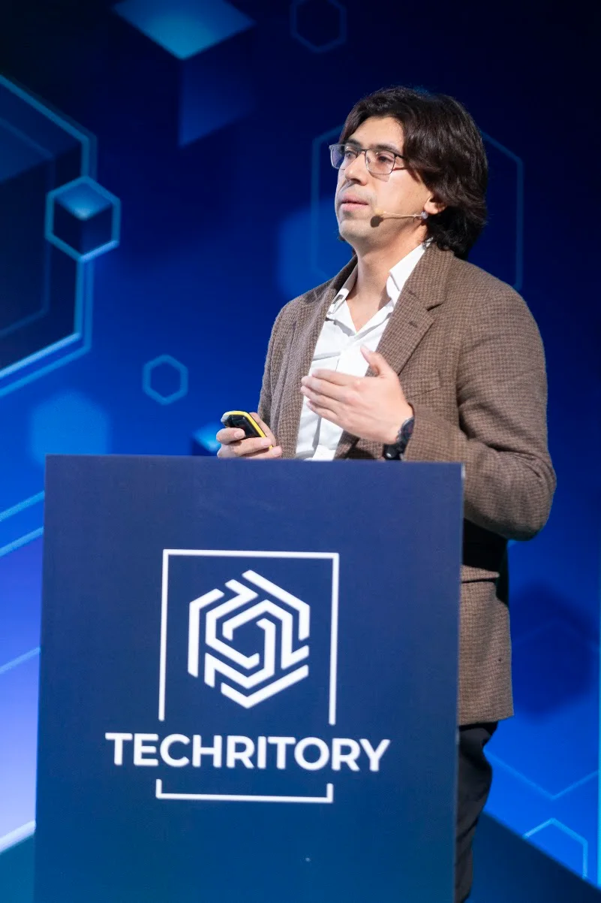
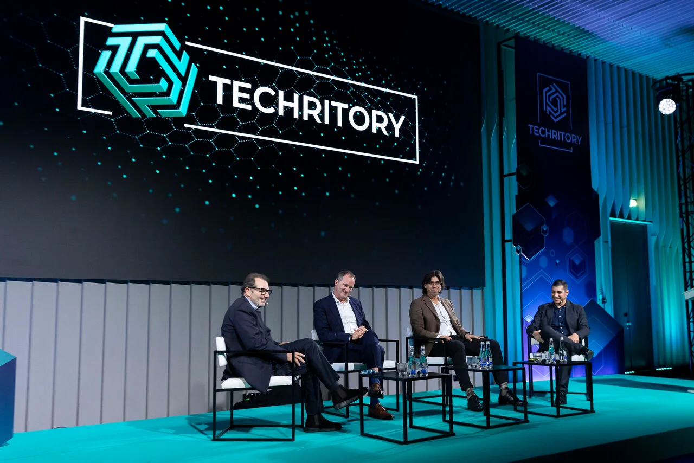
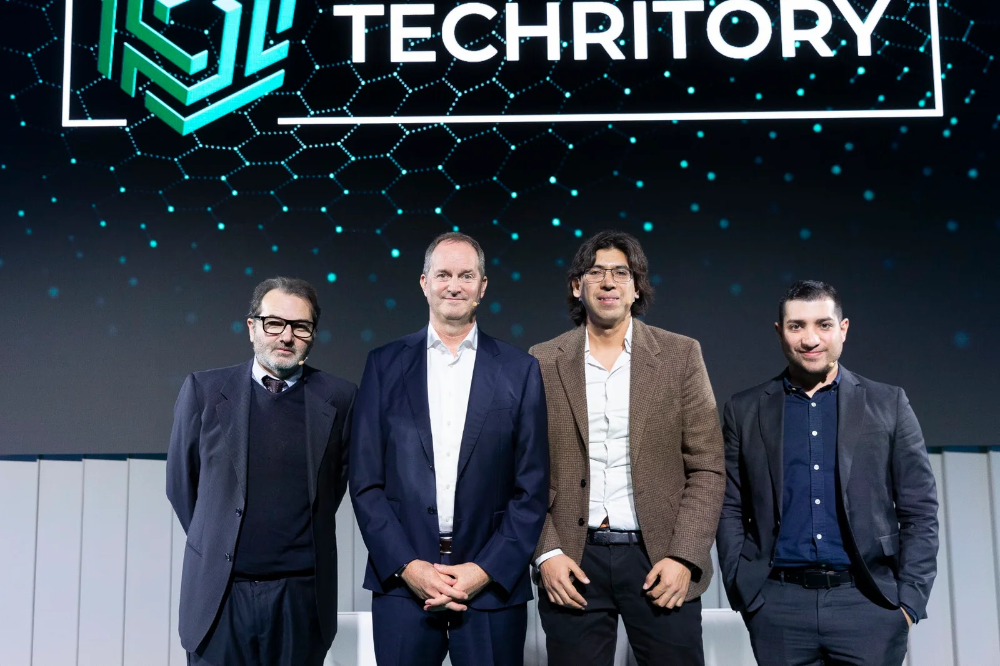
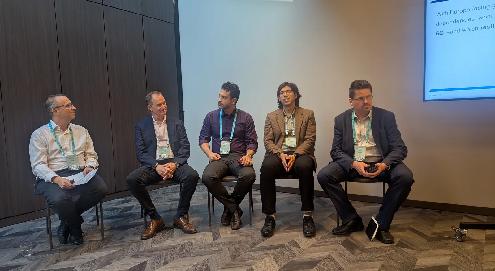

::: {.event-intro}
On 21-22 October 2026, I joined [Techritory](https://www.techritory.com/) at the ATTA Centre in Riga, Latvia, to discuss the economic and social impact of 6G and its role in Europe's resilience and competitiveness. I contributed to two sessions, including an opening presentation followed by a panel discussion.
:::

## Beyond Networks: the Economic and Social Impact of 6G

::: {.session-details}
22 October 2026 | Opening presentation and panel discussion
:::

I opened the session with a presentation of around 10 minutes before joining the panel discussion. The session explored what 6G could mean for mobile operators, businesses and the wider economy after 2030.

The panel discussion centred on four questions:

- What do we know about the economic impact of mobile connectivity?
- Which lessons from 5G can we apply to 6G?
- What are the main use cases for 6G?
- What are the challenges and opportunities for operators associated with AI, and the integration of terrestrial networks with NTN?

::: {.event-portrait .presentation-photo}
{fig-alt="Harry Aquije Ballon delivering his opening presentation at the Techritory lectern." width=801 height=1202 loading="lazy"}
:::

I joined **Raffaele de Peppe** (6G Industry Association), **Colin Willcock** (6G IA) and **Arturo Torrealba** (Telefonica) for the panel, contributing my perspective as an economist at GSMA.

::: {.panel-photos}
{fig-alt="The four Beyond Networks participants seated on stage during the panel discussion." width=1280 height=854 loading="lazy"}

{fig-alt="The four Beyond Networks participants standing together on the Techritory stage." width=1600 height=1067 loading="lazy"}
:::

::: {.recording-link}
[<i class="bi bi-youtube" aria-hidden="true"></i> Watch the session on YouTube](https://www.youtube.com/watch?v=9wL1UlDnZgE){target="_blank" rel="noopener noreferrer"}
:::

## 6G Trials for Resilient Europe: from SNS pilots to FP10 pre-deployment

::: {.session-details}
21 October 2026 | Panel discussion
:::

I also participated in a panel on how 6G can support a more resilient and competitive Europe. The wider event brought together researchers, standardisation experts, mobile operators and industry representatives to examine the path from research and trials to deployment.

The programme considered how pilots under the Smart Networks and Services (SNS) initiative could develop into larger-scale pre-deployment under the next EU research framework programme, FP10. Alongside the technical questions, the event addressed the potential economic and societal benefits of 6G, including its contribution to GDP and jobs.

{fig-alt="Five participants seated together for the 6G Trials for Resilient Europe panel." width=1600 height=879 loading="lazy"}

[Read the session programme](https://www.techritory.com/6g-trials-for-resilient-europe/).

::: {.event-footer}
[Techritory 2026](https://www.techritory.com/) | [Conference programme](https://www.techritory.com/agenda-2026/)

[Back to Talks](../index.qmd)
:::
